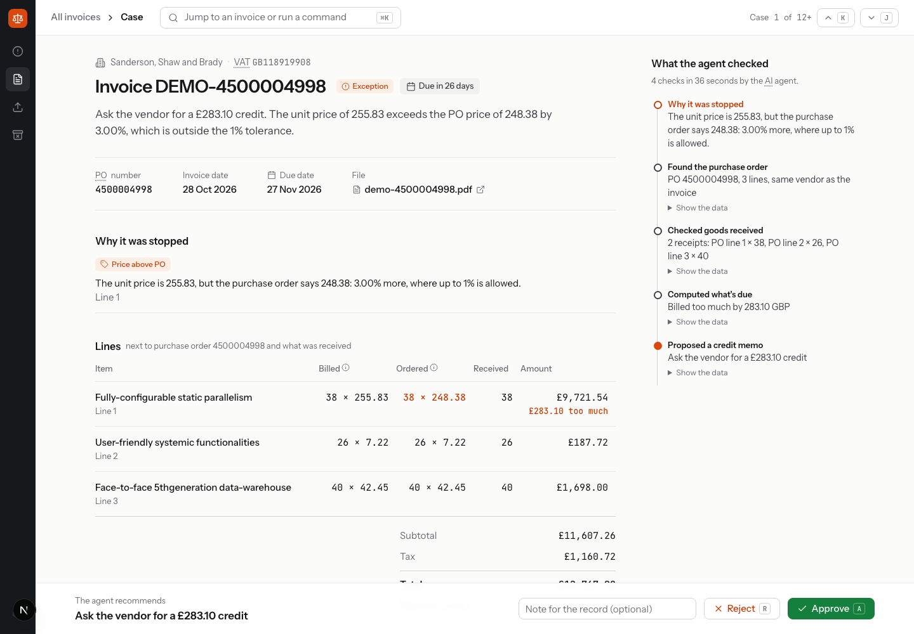
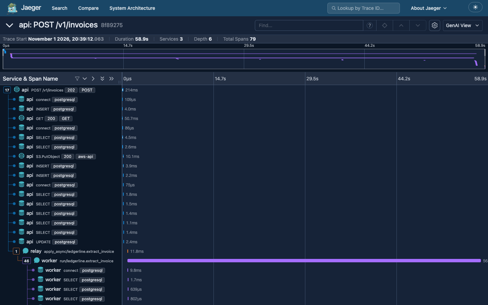
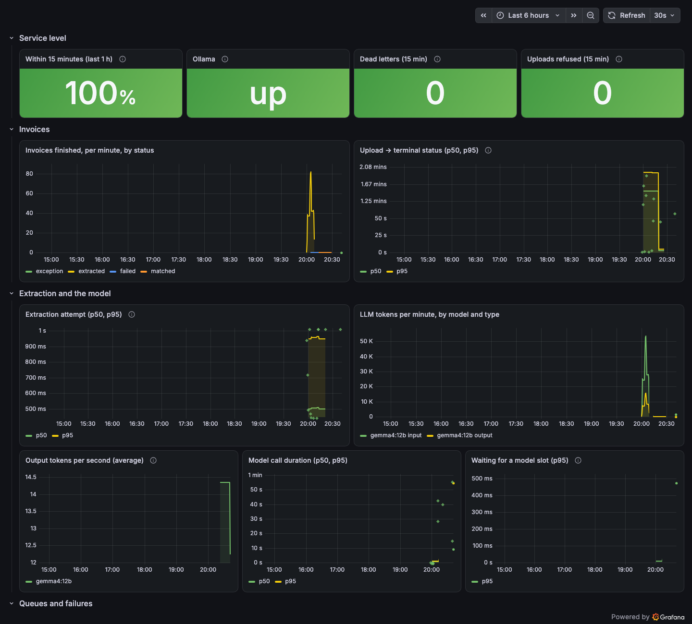

# Ledgerline

[](https://github.com/Abuubkar/ledgerline/actions/workflows/ci.yml)

Accounts-payable automation that runs on a local LLM. Ledgerline reads vendor invoice PDFs, extracts the
header and line items, matches them against purchase orders and goods receipts from an ERP, and hands
mismatches to an agent that proposes a fix (credit memo request or hold) for a person to approve.

Finance data punishes mistakes: a double-paid invoice costs real money. So the interesting parts are the
unglamorous ones: idempotent ingestion, money that is never a float, failures that are recorded instead of
guessed around, a human approving every write, and numbers instead of impressions for the AI.

> **Status: complete.** All 8 planned slices are built, tested and merged, from upload to a signed release with
> tracing, metrics and alerts. What's deliberately not done (logins, deployment, real-world invoices) is listed
> under [What's next](#whats-next).



*The reviewer's case file. The invoice was stopped because line 1 is priced 3% above its purchase order; the
agent checked the PO, the goods received and the variance, and proposes a £283.10 credit. A person decides.*

## Results

Measured on an Apple M1 Pro with 16 GB, everything local and free (`gemma4:12b` through Ollama).

| | Result | Where |
|---|---|---|
| Header fields read correctly | **100%** on the 40-invoice dev set, **99.5%** on the 20 held-out invoices | [evals/REPORT.md](evals/REPORT.md), [evals/test-split/](evals/test-split/REPORT.md) |
| Line items (F1) | **99.3%** dev, **97.1%** held out | same |
| Agent picks the right action | **15/15** dev, **10/10** held out | same |
| Scanned invoices (12 generated: tilted, faded, blurred, fax-like) | **91–98%** header fields, **81–100%** line items; misread amounts are caught by the arithmetic check | [evals/scans/](evals/scans/REPORT.md) |
| Real invoices (25 FCC filings, 5 scans) | invoice number and date **91%**; totals and lines limited by `$`-only currency (a found gap, in the backlog) | [evals/real/](evals/real/REPORT.md), [ADR 0022](docs/adr/0022-scans-and-real-invoices-eval-sets.md) |
| Model comparison | gemma4:12b vs qwen3.5:9b vs qwen2.5:7b on the same eval: quality, speed, memory | [evals/SWEEP.md](evals/SWEEP.md) |
| Speed | ~34 s of model time per page, ~73 invoices an hour on one laptop | [docs/metrics.md](docs/metrics.md) |
| Chaos test | 203 uploads, the model failing 15% of calls, a worker killed mid-run: 0 invoices lost, only the 3 corrupt files dead-lettered | [docs/metrics.md](docs/metrics.md) |
| Every pull request | 11 checks: lint, types, contracts, unit and integration tests, migration lint, UI tests, image builds, offline eval | [.github/workflows/ci.yml](.github/workflows/ci.yml) |
| Every merge | signed multi-arch images on GHCR with SBOM, provenance and a vulnerability scan | [ADR 0019](docs/adr/0019-signed-multi-arch-images-on-ghcr.md) |

The eval caught real problems along the way: a JSON schema that silently blanked one model family's amounts, and
prompt rules that made models add up subtotals they should have copied. Both are written up with before and after
numbers ([ADR 0016](docs/adr/0016-extraction-schema-accepts-bare-numbers.md),
[ADR 0017](docs/adr/0017-extraction-prompt-totals-as-printed-quantity-from-its-column.md)).

## Seeing inside it

One invoice is one trace, from the upload request through the queue to the model call and the 3-way match:



and the pipeline has a dashboard, alerts with runbooks, and an SLO (99% of invoices through within 15 minutes):



Model calls follow OpenTelemetry's GenAI conventions (model, tokens, prompt version, speed), and no invoice content
or prompt text ever leaves the process ([ADR 0020](docs/adr/0020-tracing-with-opentelemetry-and-jaeger.md),
[ADR 0021](docs/adr/0021-metrics-logs-alerts-and-the-collector.md), [docs/slo.md](docs/slo.md)).

## Try it

Needs Docker and [Ollama](https://ollama.com) (it runs natively: Docker on macOS has no GPU access). This runs the
published images, no build:

```bash
git clone https://github.com/Abuubkar/ledgerline && cd ledgerline
ollama pull gemma4:12b                                        # 7.6 GB, once
export LEDGERLINE_TAG=main                                    # or a release tag like sha-ab7ca3c
docker compose -f docker-compose.yml -f docker-compose.release.yml run --rm api alembic upgrade head
docker compose -f docker-compose.yml -f docker-compose.release.yml up -d --wait
```

Open http://localhost:3000, upload a PDF from `samples/`, and watch it go from `received` to `extracted` in
about half a minute. To see traces, metrics and the dashboard as well, add `--profile observability` to the last
command and set `TRACING=1`: Grafana on http://localhost:3001, Jaeger on http://localhost:16686.

Check what you're running first (keyless signature from this repository's release workflow):

```bash
cosign verify ghcr.io/abuubkar/ledgerline/api:main \
  --certificate-identity-regexp '^https://github.com/Abuubkar/ledgerline/\.github/workflows/release\.yml@refs/(heads/main|tags/v.+)$' \
  --certificate-oidc-issuer https://token.actions.githubusercontent.com
```

## How it works

Upload up to 50 invoice PDFs. The API stores them and answers **202** in well under a second; a queue worker
then has a local model (`gemma4:12b` via Ollama) read each page, from its text or, for scans, from the page
image, and extract the header (vendor, tax ID, invoice number, PO number, dates, currency, subtotal, tax,
total) and the line items. An invoice that cites a purchase order is then checked against that PO and its
goods receipts. Poll `GET /v1/invoices/{id}` until `status` is final:

| Status | Meaning |
|---|---|
| `matched` | Read, adds up, and every line matches its PO line (price within 1%) and the quantity received |
| `extracted` | Every page read and the numbers add up; no PO number printed, so nothing to match against |
| `partially_extracted` | Some pages couldn't be read (see `pages`); the rest are kept |
| `exception` | A person needs to look: the totals don't add up even after one repair attempt, it's a second copy of an invoice we already have (both in `invalid_fields`), or it doesn't match its PO or receipts (reasons in `match`, e.g. `price_variance`, `short_shipment`) |
| `failed` | The job gave up (see `error_code`); listed in the dead-letter queue and replayable |

```bash
curl -H "Idempotency-Key: $(uuidgen)" -F "files=@samples/inv-002.pdf;type=application/pdf" \
  localhost:8000/v1/invoices
```

```json
{
  "status": "extracted",
  "vendor_name": "Northwind Supplies Inc.",
  "invoice_number": "NW-48213",
  "invoice_date": "2026-10-02",
  "currency": "USD",
  "total": { "amount_minor": 208865, "currency": "USD" },
  "model": "gemma4:12b",
  "llm_ms": 25503
}
```

*(Response trimmed.)*

Around that:

- **A queue that doesn't lose work.** Celery on RabbitMQ quorum queues. Model outages are retried with
  exponential backoff and jitter; corrupt PDFs go straight to a dead-letter queue (`GET /v1/admin/dead-letters`)
  and can be replayed once fixed. A killed worker's job is taken over when its lease lapses.
- **Backpressure.** A Redis semaphore caps model calls across all workers, and uploads get 429 with
  `Retry-After` when too many jobs are waiting.
- **No job without its data, no data without its job.** Jobs are written to an outbox table in the same
  transaction as the upload and published by a relay.
- **Safe retries.** Every upload carries an `Idempotency-Key`; a retry returns the stored response in tens of
  milliseconds (`Idempotent-Replayed: true`), per the IETF idempotency-key draft.
- **Duplicates never reach the model.** The same invoice uploaded again is a 409 with a link to the original,
  answered in ~28 ms.
- **Partial failures are reported per file.** A multi-file upload returns 207 with one result per file.
- **Keyset pagination** with signed cursors (`GET /v1/invoices`), and the same list over GraphQL as a Relay
  connection (`POST /graphql`).
- **ERP sync that resumes.** `sync_erp` (Celery beat, every 5 min) copies POs and goods receipts from a
  paginated, rate-limited ERP, saving its cursor with every page: killed mid-sync, it picks up on the next
  page; given an expired cursor, it restarts from how far it got. A row is overwritten only by a newer ERP
  version.
- **An agent that proposes, never acts.** For an invoice in `exception`, `gemma4:12b` calls tools (PO,
  receipts, vendor history, variance) and proposes a credit memo request or a hold. Code refuses a credit memo
  before receipts and variance were checked, computes its amount itself, and caps each run at 8 tool turns
  and 90 s. A person approves or rejects (`POST /v1/pending-actions/{id}:approve`, with `If-Match`), and of
  two reviewers deciding at once exactly one wins.
- **A reviewer UI built for deciding.** One invoice at a time: why it was stopped, its lines next to the purchase
  order and what was received, the 3-way match as plain checks, the agent's steps, and Approve / Reject. ⌘K to jump
  anywhere, J/K to move through the queue, A/R to decide; if someone else decided first it says so instead of
  overwriting. ([ADR 0014](docs/adr/0014-reviewer-ui-nextjs-urql.md))
- **Errors** are RFC 9457 problem+json with stable codes, documented in [docs/problems.md](docs/problems.md).

## Design choices worth knowing

- **Money is integer minor units plus an ISO currency.** The model copies amounts as printed strings and
  code converts them; anything that would need rounding is rejected, not rounded.
  ([ADR 0003](docs/adr/0003-money-as-integer-minor-units.md))
- **The model runs locally, for free.** `gemma4:12b` through Ollama, with a JSON schema constraining its
  output, thinking off and `temperature: 0`. ([ADR 0001](docs/adr/0001-local-llm-gemma4-via-ollama.md))
- **Failures are data.** If extraction fails (model down, truncated prompt, invalid output), the upload is
  still stored with an error code, and fields the model got in the wrong shape are listed in
  `invalid_fields` instead of being guessed.
- **The OpenAPI file is the contract.** [contracts/openapi.yaml](contracts/openapi.yaml) is written first;
  `make contract-check` fails if the code would break a client generated from it, and `make codegen`
  regenerates the typed client. ([ADR 0007](docs/adr/0007-spec-first-contracts-and-graphql.md))
- **Code checks the numbers; the model never does arithmetic.** If the totals don't add up, the model gets one
  repair call naming the problem; a number is never changed to make the sum work.
  ([ADR 0010](docs/adr/0010-page-by-page-extraction-and-one-repair.md))
- **Vendors are recognized, not just read.** Each invoice links to a vendor found by its tax ID (or its
  normalized name when it prints none), so "ACME GmbH" and "ACME GMBH" are one company and a re-sent invoice
  is caught as a duplicate. The move from text columns to a vendors table ran as a 4-step expand/contract
  migration while uploads kept flowing. ([ADR 0011](docs/adr/0011-vendors-table-and-expand-contract-migration.md),
  [docs/migrations.md](docs/migrations.md))
- **The 3-way match is plain code, not the model.** Description, price (1% tolerance, compared as
  decimals) and quantity received, line by line, with every failed rule stored as a reason a person can read.
  ([ADR 0012](docs/adr/0012-erp-sync-and-three-way-match.md))
- **The agent's limits are code, not prompt.** Tool arguments are validated, guards and budgets sit in the
  loop, every step is stored, and every run ends in exactly one proposal.
  ([ADR 0013](docs/adr/0013-exception-agent-proposes-a-person-decides.md))
- **Quality is measured, not eyeballed.** A generated golden set (60 invoices, 25 agent scenarios) with gates on
  field accuracy, line-item F1, schema validity, calibration and agent accuracy; speed is reported. Model answers
  are recorded, so the eval replays offline with identical numbers. The same eval compares models
  ([evals/SWEEP.md](evals/SWEEP.md)), and it caught a schema that silently blanked one model family's amounts.
  ([ADR 0015](docs/adr/0015-evals-golden-set-gates-replay.md), [ADR 0016](docs/adr/0016-extraction-schema-accepts-bare-numbers.md),
  [evals/REPORT.md](evals/REPORT.md))
- **Leases, not long-held locks.** A worker owns an invoice through a lease it renews; a unique index allows
  only one completed extraction per invoice, so double extraction is impossible rather than unlikely.
  ([ADR 0009](docs/adr/0009-queued-extraction-with-leases-and-dead-letters.md))
- **CI gates every merge, and releases are signed.** Third-party actions are pinned to commit SHAs; images are
  scanned before they're signed, and only signed images verify.
  ([ADR 0018](docs/adr/0018-ci-checks-on-github-actions.md), [ADR 0019](docs/adr/0019-signed-multi-arch-images-on-ghcr.md))
- **Built in thin vertical slices**, each running end to end on real input, with every real choice recorded
  as an [ADR](docs/adr/). The working rules are in [HOW_WE_BUILD.md](HOW_WE_BUILD.md).

## Develop on it

Needs Docker, [uv](https://docs.astral.sh/uv/) and [Ollama](https://ollama.com) running natively (Docker on
macOS has no GPU access, so the model runs outside it).

```bash
ollama pull gemma4:12b
docker compose up -d --wait               # Postgres, RabbitMQ, Redis, SeaweedFS, worker, relay, beat, ERP mock
uv run alembic upgrade head
uv run uvicorn ledgerline_api.main:app --port 8000
pnpm --dir apps/web install && make web   # reviewer UI on http://localhost:3000 (Node 22.12+, pnpm)
```

In another terminal:

```bash
uv run python scripts/make_invoice.py     # renders samples/*.pdf with gold JSON
uv run python scripts/check_samples.py    # uploads them and compares with gold
make smoke                                # end to end with the generated client: idempotency, paging, GraphQL
make test                                 # unit tests, offline
make test-int                             # service tests against a throwaway Postgres (needs Docker)
make test-web                             # reviewer UI tests (Jest, GraphQL mocked with MSW)
make eval                                 # accuracy and speed on the golden set, replayed offline (LIVE=1: against Ollama)
uv run python evals/sweep.py [--live]     # the same eval for each model in evals/sweep.py, table in evals/SWEEP.md
make contract-check                       # code vs. contracts/openapi.yaml (needs Docker)
make lint                                 # ruff, mypy, tsc, eslint: what CI's lint job runs
TRACING=1 docker compose --profile observability up -d --wait   # plus collector, Jaeger, Prometheus, Loki, Grafana
uv run python scripts/trace_tree.py       # print the latest invoice's trace from Jaeger as a tree
make chaos                                # 200 invoices, stub model failing 15%, a worker killed mid-run; cleans up after
make seed                                 # 200 vendors, 20k invoices, 30 near-duplicates, 5k POs for the ERP mock
uv run python scripts/sync_erp.py         # one ERP sync now (beat runs it every 5 minutes anyway)
uv run python scripts/match_pending.py    # match the seeded invoices that cite a PO
uv run python scripts/agent_scenarios.py  # real model: the agent on 5 exception scenarios, with traces
uv run python scripts/check_scenarios.py  # real model: failing page, blank page, misprinted total, scan
```

Configuration is read from environment variables or `.env`; every key is listed in
[.env.example](.env.example).

## Roadmap

Each slice is one end-to-end change. The destination layout and stack are in [docs/architecture.md](docs/architecture.md).

| Slice | Delivers | Status |
|---|---|---|
| 1 | Upload one PDF → local model extracts header fields → stored → fetched | Done |
| 2 | Spec-first REST API, idempotent bulk upload, keyset pagination, typed Python client, GraphQL reads | Done |
| 3a | Queued extraction (Celery + RabbitMQ): retries, dead letters + replay, backpressure, outbox, chaos test | Done |
| 3b | Per-page extraction, line items, scanned pages, arithmetic check with one repair call | Done |
| 4a | Vendors table via a live expand/contract migration, duplicate-invoice guard, seed data | Done |
| 4b | ERP mock, resumable ERP sync on Celery beat, 3-way match, `matched` status | Done |
| 5a | Exception agent (tool calling, guards, budgets), pending actions, ETag approval in REST and GraphQL | Done |
| 5b | Reviewer UI (Next.js + urql): queue, case file, decisions, upload, dead letters; Jest tests | Done |
| 6a | Golden set of 60 invoices and 25 agent scenarios, eval script with gates, recorded answers | Done |
| 6b | Model sweep: gemma4:12b, qwen3.5:9b, qwen2.5:7b on the same eval ([evals/SWEEP.md](evals/SWEEP.md)) | Done |
| 6c | Extraction prompt v4 from the sweep's findings: gemma4 at 100% header fields, 99.3% line items | Done |
| 7a | GitHub Actions on every PR: lint, contracts, unit and integration tests, migration lint, web tests, offline eval | Done |
| 7b | Release: signed multi-arch images to GHCR with SBOM, provenance and a vulnerability scan | Done |
| 8a | OpenTelemetry tracing: one invoice traced from upload through the model call to the match; agent and approval traces; Jaeger | Done |
| 8b | Metrics, logs in Loki, Grafana dashboard, alerts with runbooks, SLO with burn-rate alerts, tail sampling, release compose | Done |

## What's next

Deliberately out of scope so far, in rough order of value:

- **What the real invoices found.** Take the currency from the PO when an invoice prints only `$`; check VAT IDs'
  check digits (scans misread digits); detect sideways scans. Details in [docs/backlog.md](docs/backlog.md).
- **Logins and roles.** A decision records when and why, but not who.
- **Start the agent automatically** when an invoice lands in `exception` (today a script queues it).
- **Deploy it.** The signed images and the release compose file are ready; nothing runs them on a server.
- **Alertmanager**, so alerts reach someone; and the smaller items in [docs/backlog.md](docs/backlog.md).

What went wrong along the way, and why each fix was chosen over the alternatives, is in
[docs/challenges.md](docs/challenges.md).


## Layout

```text
apps/api/                 FastAPI app, Celery worker, outbox relay, agent, SQLAlchemy models, migrations, tests
apps/erp_mock/            a stand-in ERP: purchase orders and goods receipts behind a flaky, paginated API
apps/web/                 reviewer UI (Next.js, urql, GraphQL codegen, Jest + MSW)
packages/telemetry/       one OpenTelemetry setup for every service, with redaction
packages/clients/python/  typed client generated from the contract; never edited by hand
contracts/                openapi.yaml (source of truth), schema.graphql (exported from code)
evals/                    golden set, scoring, recorded model answers, reports, model sweep, archive
infra/                    RabbitMQ topology, OpenTelemetry Collector, Prometheus rules, Loki, Grafana dashboard
scripts/                  invoice generator, seed, chaos test, end-to-end checks, trace printer
docs/                     ADRs, metrics history, SLO, runbooks, challenges, backlog
```

## Documentation

| | |
|---|---|
| [docs/adr/](docs/adr/) | 22 decisions: what was chosen, why, and the alternatives |
| [docs/metrics.md](docs/metrics.md) | every measurement, slice by slice, with the latest per model at the top |
| [docs/challenges.md](docs/challenges.md) | what went wrong, what we did, why, and what else we could have done |
| [docs/backlog.md](docs/backlog.md) | improvements found and deliberately parked, with their cost |
| [docs/slo.md](docs/slo.md), [docs/runbooks/](docs/runbooks/) | the service level objective and what to do when each alert fires |
| [HOW_WE_BUILD.md](HOW_WE_BUILD.md) | the working rules this was built under |
