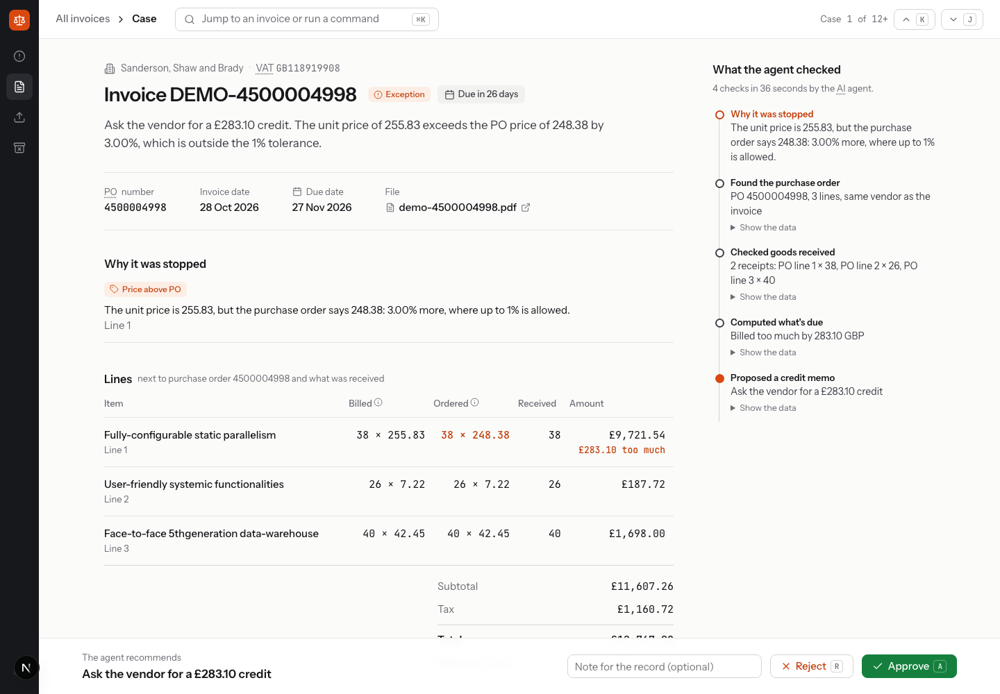
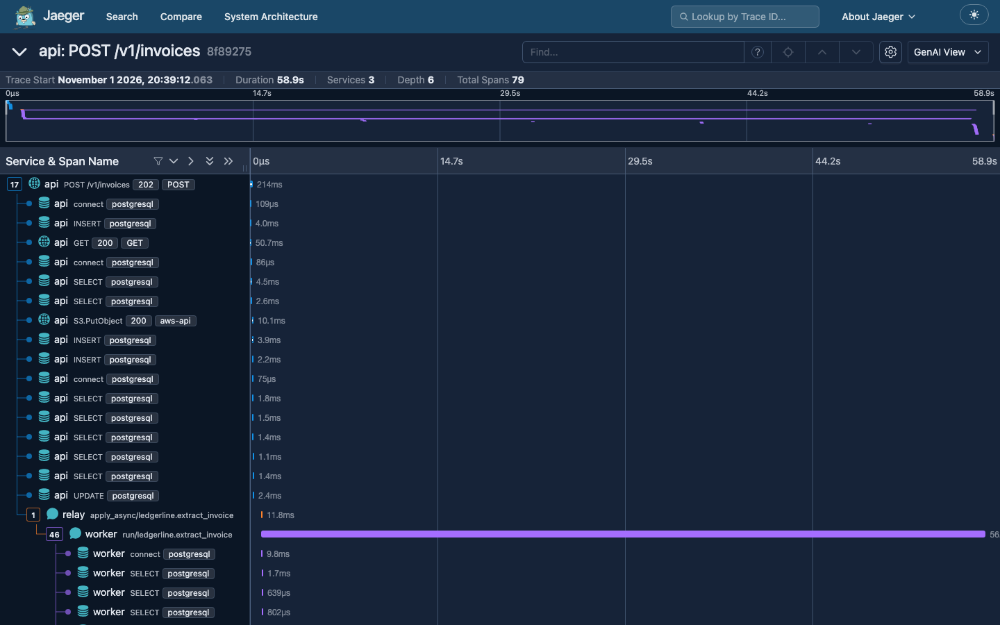
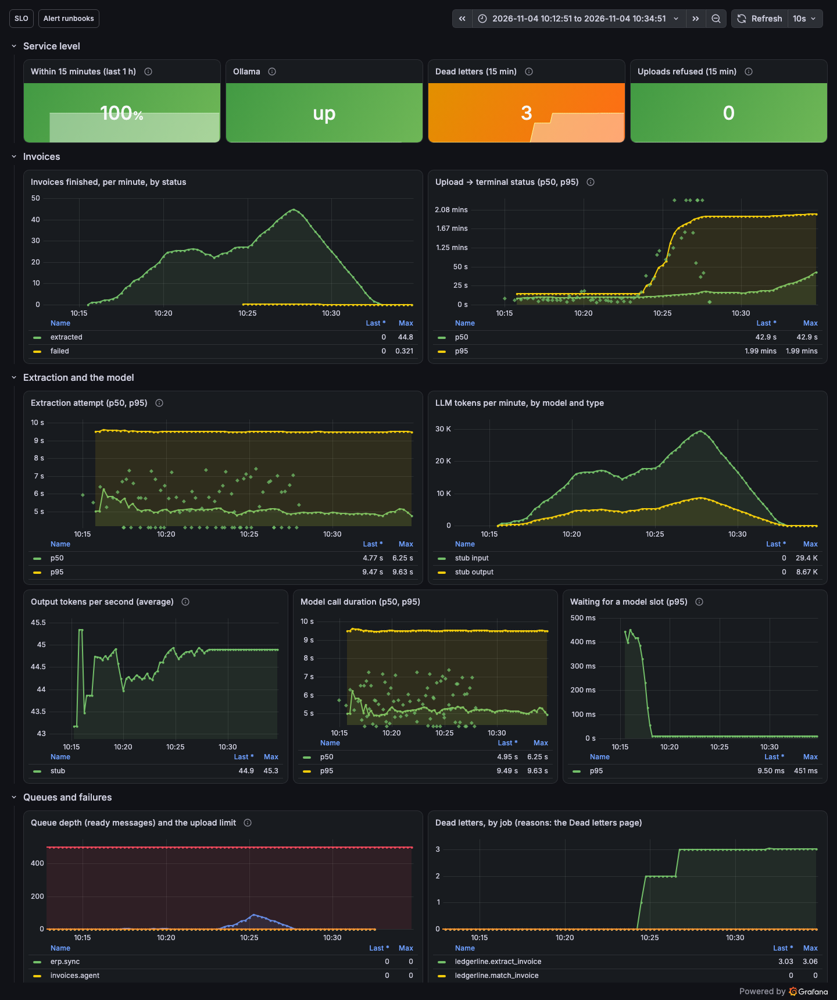
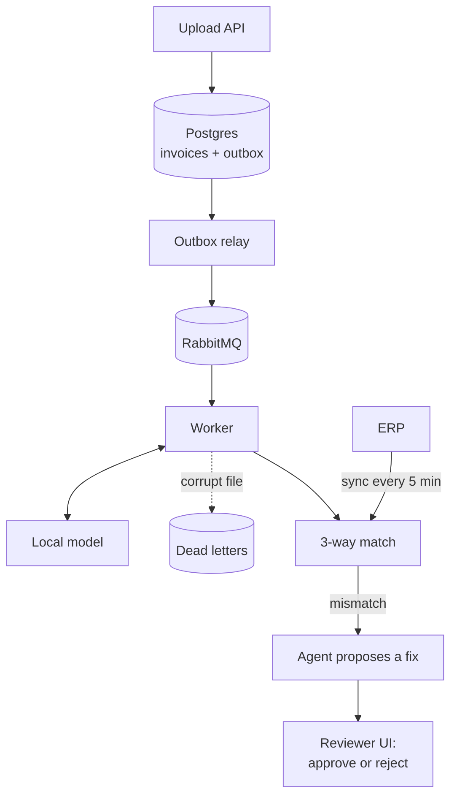

# Ledgerline

[](https://github.com/Abuubkar/ledgerline/actions/workflows/ci.yml)
[](https://github.com/Abuubkar/ledgerline/actions/workflows/release.yml)

**Accounts-payable automation on a local model: invoice PDFs in, matched invoices out, and a person approving every fix.**

Ledgerline reads vendor invoices, extracts the header and line items, and checks them against the purchase orders
and goods receipts in an ERP. When an invoice doesn't match, an agent looks into it and proposes a credit memo
request or a hold, and a person decides. Finance data punishes mistakes (a double-paid invoice is real money), so
uploads are idempotent, money is never a float, and failures are recorded instead of guessed around. Everything runs
locally, including the model.

> **Status: complete.** All 8 planned slices are built, tested and merged. Known gaps are listed under
> [Limitations](#limitations).



*An invoice stopped because line 1 is priced 3% above its purchase order. The agent checked the PO, the goods
received and the variance, and proposes a £283.10 credit. A person decides.*

## Highlights

- **Never pays twice.** Every upload carries an idempotency key, a re-sent invoice is caught as a duplicate before
  the model sees it, and a unique index makes a second extraction of the same invoice impossible.
- **Loses nothing.** 203 uploads with the model failing 15% of calls and a worker killed mid-run: none lost, and
  exactly the 3 corrupt files dead-lettered, ready to replay.
- **Money is exact.** Integer minor units and a currency, never floats. The model copies amounts as printed; code
  does every sum and refuses anything that would need rounding.
- **A person decides.** The agent only proposes. Its limits are in code, not the prompt, and when two reviewers
  approve at once, exactly one wins.
- **Measured, not eyeballed.** A 60-invoice golden set with gates, replayed on every pull request. Three models
  compared on it, and scanned and real invoices reported as measured.
- **Observable end to end.** One invoice is one trace from upload to the model call to the match, with a
  dashboard, an SLO and alerts with runbooks.

## Results

Measured on an Apple M1 Pro laptop with 16 GB, with `gemma4:12b` running locally through Ollama. Where two numbers
are given, the first is the 40-invoice dev set and the second the 20 held-out invoices.

| | Result | Target | Where |
|---|---|---|---|
| Header fields read correctly | **100% / 99.5%** | ≥ 97% | [dev](evals/REPORT.md), [held out](evals/test-split/REPORT.md) |
| Worst single header field | **100% / 95.0%** | ≥ 93% | [dev](evals/REPORT.md), [held out](evals/test-split/REPORT.md) |
| Line items (F1) | **99.3% / 97.1%** | ≥ 95% | [dev](evals/REPORT.md), [held out](evals/test-split/REPORT.md) |
| Answers in the required JSON shape | **100% / 100%** | ≥ 98% | [dev](evals/REPORT.md), [held out](evals/test-split/REPORT.md) |
| Fields the model was sure of but got wrong | **0.0% / 0.5%** | ≤ 2% | [dev](evals/REPORT.md), [held out](evals/test-split/REPORT.md) |
| Agent picks the right action | **15/15 / 10/10** | ≥ 85% | [dev](evals/REPORT.md), [held out](evals/test-split/REPORT.md) |
| Chaos: 203 uploads, model failing 15% of calls, a worker killed | **0 lost**, 3/3 corrupt files dead-lettered | 0 lost | [chaos run](docs/metrics.md#slice-3a-chaos-test-stub-model) |
| Speed | ~34 s of model time per page, ~73 invoices an hour | reported | [metrics](docs/metrics.md#latest-eval-results-per-model) |

Where it falls short. Scanned and real invoices are measured, not gated; the golden set's gate is shown for
comparison:

| | Result | Gate | Where |
|---|---|---|---|
| Scans: header fields | 91.2% | ≥ 97% | [scans report](evals/scans/REPORT.md) |
| Scans: VAT IDs (a digit misread) | 50% | ≥ 93% | [scans report](evals/scans/REPORT.md) |
| Scans: line items (F1) | 81.0% | ≥ 95% | [scans report](evals/scans/REPORT.md) |
| Scans: fields the model was sure of but got wrong | 8.9% | ≤ 2% | [scans report](evals/scans/REPORT.md) |
| Real invoices: invoice number and date | 91.3% | ≥ 97% | [real report](evals/real/REPORT.md) |
| Real invoices: total (US invoices print only `$`) | 34.8% | ≥ 97% | [real report](evals/real/REPORT.md) |
| Real invoices: line items (F1) | 37.0% | ≥ 95% | [real report](evals/real/REPORT.md) |

The same eval compared three models ([evals/SWEEP.md](evals/SWEEP.md)) and caught two real problems: a JSON schema
that silently blanked one model family's amounts, and prompt rules that let models add up subtotals they should
have copied ([ADR 0016](docs/adr/0016-extraction-schema-accepts-bare-numbers.md),
[ADR 0017](docs/adr/0017-extraction-prompt-totals-as-printed-quantity-from-its-column.md)).

## Seeing inside it

One invoice as a trace: the upload request, the relay publishing the job, the worker's extraction with the model
call taking almost all of its 59 seconds, then the 3-way match.



The pipeline's dashboard during 15 minutes of uneven uploads (384 invoices), with a stub model standing in for
Ollama and failing about 12% of its calls: a wave and then a burst queued and drained, 50 failed calls retried, 3
corrupt files dead-lettered, and the SLO (99% of invoices through within 15 minutes) holding.



Model calls follow OpenTelemetry's GenAI conventions (model, tokens, prompt version, speed), and no invoice content
or prompt text ever leaves the process.

## Quick start

You need Docker and [Ollama](https://ollama.com). The model runs on the host, because Docker on macOS has no GPU
access. This runs the published images, no build needed:

```bash
git clone https://github.com/Abuubkar/ledgerline && cd ledgerline
ollama pull gemma4:12b                # 7.6 GB, once
docker compose -f docker-compose.yml -f docker-compose.release.yml up -d --wait
```

The first start applies the database migrations. Then upload the sample invoices (or drag them onto the UI's
Upload page):

```bash
for f in samples/*.pdf; do
  curl -s -H "Idempotency-Key: $(uuidgen)" -F "files=@$f;type=application/pdf" localhost:8000/v1/invoices; echo
done
```

| Open | What you'll see |
|---|---|
| http://localhost:3000 | The reviewer queue: each invoice goes from `received` to `extracted` in about half a minute |
| http://localhost:3001 | Grafana: the pipeline dashboard, the SLO and the alerts |
| http://localhost:16686 | Jaeger: one invoice's path from upload through the queue to the model call |

`LEDGERLINE_TAG=sha-<commit>` pins a release; the default is `main`, the latest merge. The images are signed by this
repository's release workflow. To check before running:

```bash
cosign verify ghcr.io/abuubkar/ledgerline-api:main \
  --certificate-identity-regexp '^https://github.com/Abuubkar/ledgerline/\.github/workflows/release\.yml@refs/(heads/main|tags/v.+)$' \
  --certificate-oidc-issuer https://token.actions.githubusercontent.com
```

## How it works



1. **Upload.** Up to 50 PDFs per request, stored and answered in well under a second (202, or 207 with a result per
   file). A retry with the same `Idempotency-Key` gets the stored response; a re-sent invoice is a 409 pointing at
   the original; when too many jobs are waiting, uploads get 429 with `Retry-After`.
2. **Queue.** The job is written to an outbox in the same transaction as the upload, so there's never a job without
   its data or data without its job. Model outages are retried with backoff and jitter, corrupt files go to dead
   letters (replayable once fixed), and a killed worker's job is taken over when its lease lapses.
3. **Extract.** The local model reads each page, from its text or, for scans, from the page image, and copies the
   header and line items exactly as printed. Code converts the amounts and checks that the lines, subtotal, tax
   and total add up. If they don't, the model gets one repair call naming the problem; a number is never changed
   to make a sum work.
4. **Match.** A sync copies purchase orders and goods receipts from the ERP every 5 minutes and resumes where it
   stopped. An invoice that cites a PO is checked line by line, in plain code: description, price within 1%, and
   quantity received.
5. **Propose, then decide.** For an invoice in `exception`, the agent calls tools (PO, receipts, vendor history,
   variance) and proposes a credit memo request or a hold. Code refuses a credit memo before the receipts and the
   variance were checked, computes its amount itself, and caps each run at 8 tool turns and 90 s. A person
   approves or rejects.

Every invoice ends in one of these:

| Status | Meaning |
|---|---|
| `matched` | Read, adds up, and every line matches its PO line (price within 1%) and the quantity received |
| `extracted` | Every page read and the numbers add up; no PO number printed, so nothing to match against |
| `partially_extracted` | Some pages couldn't be read (see `pages`); the rest are kept |
| `exception` | A person needs to look: totals that don't add up after the repair, a second copy of an invoice we already have, or a mismatch with its PO or receipts (reasons in `match`, e.g. `price_variance`, `short_shipment`) |
| `failed` | The job gave up (see `error_code`); listed in the dead letters and replayable |

### The API

The UI is built on a REST API on `:8000`, written first as [contracts/openapi.yaml](contracts/openapi.yaml). Upload
an invoice, then poll it until its status is final:

```bash
curl -H "Idempotency-Key: $(uuidgen)" -F "files=@samples/inv-002.pdf;type=application/pdf" \
  localhost:8000/v1/invoices
```

```json
{
  "status": "extracted",
  "vendor_name": "Northwind Supplies Inc.",
  "invoice_number": "NW-48213",
  "invoice_date": "2026-10-02",
  "currency": "USD",
  "total": { "amount_minor": 208865, "currency": "USD" },
  "model": "gemma4:12b",
  "llm_ms": 25503
}
```

*(`GET /v1/invoices/{id}`, trimmed.)*

Invoices waiting for a person, newest first, paged with a signed cursor. `match` says why each one stopped:

```bash
curl 'localhost:8000/v1/invoices?status=exception&limit=1'
```

```json
{
  "data": [
    {
      "id": "4ab15b9e-9874-4338-8974-48045755a7ae",
      "status": "exception",
      "vendor_name": "Sanderson, Shaw and Brady",
      "invoice_number": "DEMO-4500004998",
      "po_number": "4500004998",
      "total": { "amount_minor": 1276798, "currency": "GBP" },
      "match": {
        "status": "exception",
        "reasons": [
          {
            "code": "price_variance",
            "detail": "unit price 255.83 vs PO 248.38 (+3.00%, tolerance 1%)",
            "line": "page 1 line 1"
          }
        ]
      }
    }
  ],
  "next_cursor": "eyJ0IjoiMjAyNi0xMS0wMVQxNTozOToxMi4xMjgy..."
}
```

*(Trimmed.)* The agent's proposal for it, from `GET /v1/invoices/{id}/pending-actions`, is a credit memo request
for £283.10 (`"amount_minor": 28310`, computed by code) at version 1, which is also its `ETag`.

A decision names the version it was made on. If someone decided first, it's refused instead of overwriting theirs:

```bash
curl -X POST -H 'If-Match: "1"' -H 'Content-Type: application/json' -d '{"note": "Vendor confirmed the PO price"}' \
  localhost:8000/v1/pending-actions/01a197c5-5682-7d4c-b1ce-a41ed65339b1:approve
```

```json
{
  "title": "Version conflict",
  "status": 412,
  "detail": "the pending action is at version 1, not 0; reload it and decide again",
  "code": "version_conflict",
  "current_version": 1
}
```

*(The answer with a stale `If-Match: "0"`, trimmed.)*

The same invoices and decisions are on GraphQL at `/graphql` (Relay connections), and dead letters are listed and
replayed under `/v1/admin/dead-letters`. Errors are RFC 9457 problem+json with a stable `code`, each documented in
[docs/problems.md](docs/problems.md).

## Design decisions

| Decision | Why | ADR |
|---|---|---|
| Money as integer minor units plus a currency | No float ever touches money; anything that would need rounding is rejected | [0003](docs/adr/0003-money-as-integer-minor-units.md) |
| A local model (`gemma4:12b`) through Ollama | Free and private; the best quality of the three models measured | [0001](docs/adr/0001-local-llm-gemma4-via-ollama.md), [sweep](evals/SWEEP.md) |
| Code checks the numbers, the model only copies | One repair call naming the problem; a printed number is never changed to fit | [0010](docs/adr/0010-page-by-page-extraction-and-one-repair.md) |
| Idempotency keys per the IETF draft | A retried upload returns the stored response instead of a second invoice | [0005](docs/adr/0005-idempotency-keys-per-ietf-draft.md) |
| The OpenAPI file is the contract | Written first; CI fails if code would break a generated client | [0007](docs/adr/0007-spec-first-contracts-and-graphql.md) |
| A queue with an outbox, leases and dead letters | No lost jobs, no double extraction, and failures that can be replayed | [0009](docs/adr/0009-queued-extraction-with-leases-and-dead-letters.md) |
| Vendors table, migrated online | Found by tax ID, so a re-sent invoice is caught; the switch ran while uploads kept flowing | [0011](docs/adr/0011-vendors-table-and-expand-contract-migration.md) |
| 3-way match in plain code | Deterministic, and every failed rule is a reason a person can read | [0012](docs/adr/0012-erp-sync-and-three-way-match.md) |
| The agent proposes, a person decides | Guards, budgets and money come from code; every run ends in exactly one proposal | [0013](docs/adr/0013-exception-agent-proposes-a-person-decides.md) |
| A golden set with gates, replayed offline | Every pull request reruns it on the recorded answers, without a GPU | [0015](docs/adr/0015-evals-golden-set-gates-replay.md) |
| Signed multi-arch images | Scanned before they're signed; only signed images verify | [0019](docs/adr/0019-signed-multi-arch-images-on-ghcr.md) |
| OpenTelemetry from upload to model call | One invoice is one trace; no invoice content ever leaves the process | [0020](docs/adr/0020-tracing-with-opentelemetry-and-jaeger.md), [0021](docs/adr/0021-metrics-logs-alerts-and-the-collector.md) |

## Development

You need Docker, [uv](https://docs.astral.sh/uv/), [pnpm](https://pnpm.io) and Ollama.

```bash
docker compose up -d --wait               # Postgres, RabbitMQ, Redis, SeaweedFS, worker, relay, beat, ERP mock
uv run alembic upgrade head
uv run uvicorn ledgerline_api.main:app --port 8000
pnpm --dir apps/web install && make web   # reviewer UI on :3000
TRACING=1 docker compose --profile observability up -d --wait   # add the observability stack
```

```bash
make test         # unit tests, offline
make test-int     # against a throwaway Postgres (needs Docker)
make test-web     # reviewer UI tests
make eval         # accuracy on the golden set, model answers replayed (LIVE=1: against Ollama)
make chaos        # 200 invoices, a stub model failing 15%, a worker killed mid-run
make lint         # what CI's lint job runs
```

Every command is in [CLAUDE.md](CLAUDE.md#run-it), and every setting in [.env.example](.env.example).

## Roadmap

Built in thin slices, each one end to end. The destination is in [docs/architecture.md](docs/architecture.md).

| Slice | Delivers | Status |
|---|---|---|
| 1 | Upload one PDF → local model extracts header fields → stored → fetched | Done |
| 2 | Spec-first REST API, idempotent bulk upload, keyset pagination, typed Python client, GraphQL reads | Done |
| 3a | Queued extraction (Celery + RabbitMQ): retries, dead letters + replay, backpressure, outbox, chaos test | Done |
| 3b | Per-page extraction, line items, scanned pages, arithmetic check with one repair call | Done |
| 4a | Vendors table via a live expand/contract migration, duplicate-invoice guard, seed data | Done |
| 4b | ERP mock, resumable ERP sync on Celery beat, 3-way match, `matched` status | Done |
| 5a | Exception agent (tool calling, guards, budgets), pending actions, ETag approval in REST and GraphQL | Done |
| 5b | Reviewer UI (Next.js + urql): queue, case file, decisions, upload, dead letters; Jest tests | Done |
| 6a | Golden set of 60 invoices and 25 agent scenarios, eval script with gates, recorded answers | Done |
| 6b | Model sweep: gemma4:12b, qwen3.5:9b, qwen2.5:7b on the same eval ([evals/SWEEP.md](evals/SWEEP.md)) | Done |
| 6c | Extraction prompt v4 from the sweep's findings: gemma4 at 100% header fields, 99.3% line items | Done |
| 7a | GitHub Actions on every PR: lint, contracts, unit and integration tests, migration lint, web tests, offline eval | Done |
| 7b | Release: signed multi-arch images to GHCR with SBOM, provenance and a vulnerability scan | Done |
| 8a | OpenTelemetry tracing: one invoice traced from upload through the model call to the match; agent and approval traces; Jaeger | Done |
| 8b | Metrics, logs in Loki, Grafana dashboard, alerts with runbooks, SLO with burn-rate alerts, tail sampling, release compose | Done |

## Limitations

- **US invoices lose their totals.** They print `$`, never "USD", so no currency is read and amounts can't be
  converted: on the real set the total was empty on 14 of 23 invoices.
- **Scans misread single digits** in VAT IDs (4 of 8), and nothing checks them yet, so a misread ID can link an
  invoice to the wrong vendor.
- **Real pages are slow and sometimes sideways.** Dense real pages take 80–147 s of model time; a two-page sideways
  scan timed out.
- **A stamp drawn as text over line items scrambles them**, for every model (2 of 139 lines in the dev set).
- **The agent starts by script**, not automatically when an invoice lands in `exception`.
- **No logins, no paging.** A decision records when and why, but not who; alerts show in Prometheus and Grafana,
  with no Alertmanager route.
- **Not deployed.** The signed images and the release compose file are ready; nothing runs them on a server.

Each has a suggested fix and its cost in [docs/backlog.md](docs/backlog.md). What went wrong along the way, and why
each fix was chosen, is in [docs/challenges.md](docs/challenges.md).

## Repository layout

```text
apps/api/                 FastAPI app, Celery worker, outbox relay, agent, SQLAlchemy models, migrations, tests
apps/erp_mock/            a stand-in ERP: purchase orders and goods receipts behind a flaky, paginated API
apps/web/                 reviewer UI (Next.js, urql, GraphQL codegen, Jest + MSW)
packages/telemetry/       one OpenTelemetry setup for every service, with redaction
packages/clients/python/  typed client generated from the contract; never edited by hand
contracts/                openapi.yaml (source of truth), schema.graphql (exported from code)
evals/                    golden, scans and real sets, scoring, recorded model answers, reports, model sweep, archive
infra/                    RabbitMQ topology, OpenTelemetry Collector, Prometheus rules, Loki, Grafana dashboard
scripts/                  invoice generator, seed, chaos test, end-to-end checks, trace printer
docs/                     ADRs, metrics history, SLO, runbooks, challenges, backlog
```

## Documentation

| | |
|---|---|
| [docs/adr/](docs/adr/) | 24 decisions: what was chosen, why, and the alternatives |
| [docs/metrics.md](docs/metrics.md) | every measurement, slice by slice, with the latest per model at the top |
| [docs/challenges.md](docs/challenges.md) | what went wrong, what we did, why, and what else we could have done |
| [docs/backlog.md](docs/backlog.md) | improvements found and deliberately parked, with their cost |
| [docs/slo.md](docs/slo.md), [docs/runbooks/](docs/runbooks/) | the service level objective and what to do when each alert fires |
| [HOW_WE_BUILD.md](HOW_WE_BUILD.md) | the working rules this was built under |
